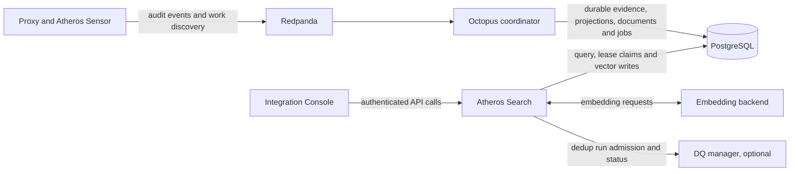

# Atheros Search

Atheros Search is a wireless-audit investigation platform. It turns durable
wireless and proxy evidence into an authenticated search experience for finding
devices, explaining results, exploring network relationships, reviewing
identity candidates, and monitoring the embedding pipeline behind semantic
search.

The project is intentionally more than a search UI. It is a production-oriented
control plane with explicit data ownership, a fenced vector-processing workflow,
least-privilege PostgreSQL access, and a browser client that never bypasses the
API boundary.

## What it delivers

| Capability | What an operator can do | How the system keeps it credible |
|---|---|---|
| Search and explain | Find wireless events, devices, proxy events and blocked-host windows; inspect why a result ranked | Dense, sparse and hybrid retrieval run against search-facing PostgreSQL projections |
| Network investigation | Explore devices, access points, clients, alerts and their observed relationships | The UI distinguishes frame evidence from verified connectivity and marks bounded results explicitly |
| Asset and identity review | Browse inventory, inspect merge candidates and record final decisions | Candidate similarity is kept separate from confirmed identity; final decisions are role-protected and durable |
| Semantic enrichment | Turn prepared document text into 768-dimension vectors | Workers claim jobs with a token and fence, call the embedding backend outside a transaction, then atomically write and complete the matching job |
| Operational visibility | Inspect job state, workers, data freshness and semantic-backend health | Readiness, Prometheus metrics, ETL health, structured logs and OTLP tracing expose the real operating state |

## Architecture



Octopus is the system of record for ingestion, deduplication, evidence,
projection maintenance and alert derivation. Atheros Search is deliberately not
a second coordinator: it serves the public query surface and owns embedding-job
execution. The browser consumes the API only. It never has database credentials,
API secrets, or authority to make a server-side authorization decision.

## Engineering characteristics

### Clear data ownership

The design prevents accidental split-brain coordination. Producers publish to
Redpanda; Octopus makes the durable state and search projections; Atheros Search
queries that state and completes only the worker lifecycle it owns. Canonical
DDL and grants live outside the application in the
[Atheros Search PostgreSQL manifest](../../sql/postgres/atheros_search/manifest.yaml).
At startup, the API verifies the selected database, TLS configuration, vector
capability and recorded schema checksum before serving traffic.

### Safe, retryable embedding work

Embedding is an at-least-once workflow, not a best-effort background call.
Workers commit token-and-fence lease ownership before external I/O, renew long
leases, recover expired claims within a bound, and atomically persist the vector
with terminal job state. A stale worker cannot complete a job it no longer owns.
Interactive queries and bulk workers also use separate capacity and
circuit-breaker lanes so enrichment load cannot silently consume all search
capacity.

### Security and privacy by design

Production API access uses RS256 Keycloak JWT validation with exact issuer and
audience checks. Operator and admin actions are enforced by the API, not by the
UI. The service avoids raw queries, tokens, session identifiers and full MAC
addresses in ordinary logs and metrics; search analytics use hashed identifiers.
See the [privacy boundary](../../docs/atheros-search-privacy.md) for the
handling model.

### Honest reporting semantics

The product avoids presenting uncertain radio observations as facts. An access
point association is observed frame evidence, not proof of a verified session.
A similarity candidate is a pending review item, not a confirmed identity.
The [reporting data contract](../../docs/atheros-reporting-data-contract.md)
defines those distinctions and the [reporting workmap](../../docs/atheros-reporting-workmap.md)
separates implemented behaviour from proposed improvements.

## Product surfaces

| Surface | Technology | Responsibility |
|---|---|---|
| [Atheros Search API](atheros-search/) | Go, HTTP, gRPC, PostgreSQL/pgvector | Search, explain, graph, inventory, ETL health, saved views, embedding claims and vector writes |
| [Integration Console](atheros-search-ui/) | SolidJS, Bun, Vite, Keycloak | Authenticated Search, Explain, Graph and Inventory workflows |
| Optional DQ integration | Go HTTP client and [DQ manager](../../services/dq/README.md) | Explicit dedup-run admission and status; disabled until both API and policy gates are enabled |

The API listens on HTTP 8080, gRPC 50051 and Prometheus 9090. The UI is a
static application that reverse-proxies `/v1/` to the in-cluster API, preserving
a single browser-facing API origin while keeping the API as the policy boundary.

## Technology and delivery

| Area | Choices |
|---|---|
| API and workers | Go, pgx, gRPC, Protobuf, OpenTelemetry, Prometheus |
| UI | SolidJS, TypeScript, Bun, Vite, D3, Keycloak |
| Durable data | PostgreSQL, pgvector, table-level grants, manifest checksum verification |
| Event plane | Redpanda and the Scala/Cats Effect/FS2 Octopus coordinator |
| Delivery | Docker images, Kustomize, Argo CD, digest-pinned production promotion |

The reviewed Kubernetes definition for both workloads lives in
[`cyber-stack/base/atheros-search`](../../cyber-stack/base/atheros-search/).
Production image digests and environment-specific API settings are reviewed in
[`cyber-stack/matrix/prod/app-stack`](../../cyber-stack/matrix/prod/app-stack/).
Argo CD reconciles that desired state; changes to configuration, routing,
network policy, scaling and image promotion are Git changes, not interactive
cluster edits.

## Repository map

```text
atheros-search/
|- atheros-search/               # Go API, background workers and public protobuf contract
|  |- cmd/server/                # Service entry point
|  |- cmd/embedding-job-repair/  # Bounded operator repair CLI
|  |- internal/                  # Search, reporting, workers, auth, database and transport packages
|  |- docs/                      # Contract, package-boundary and quality rules
|  |- proto/                     # Versioned gRPC/protobuf API definition
|  `- testdata/contracts/        # Synthetic compatibility fixtures shared with the UI
`- atheros-search-ui/            # SolidJS application
   |- src/api/                   # Typed API client and runtime response validation
   |- src/auth/                  # Keycloak session and safe return-path handling
   |- src/pages/                 # Search, Explain, Graph and Inventory views
   `- tests/                     # Unit, accessibility and browser coverage
```

## Quality gates

The project validates the boundaries that matter as much as happy-path output:

```bash
make atheros-search-test          # Go unit and integration-style tests
make atheros-search-quality       # Format, vet, race, lint, boundaries, Protobuf and fixtures
make atheros-search-ui-check      # UI tests and production build
make atheros-search-stack-contract
make atheros-search-db-contract
```

The database and stack-contract checks exercise canonical manifests, runtime
grants and cross-project contracts. The exact requirements are documented in
the [Atheros Search quality guide](atheros-search/docs/quality.md).

## Technical references

| Topic | Reference |
|---|---|
| API routes, environment, workers and repair | [Atheros Search API README](atheros-search/README.md) |
| UI development and browser/API contract | [Integration Console UI README](atheros-search-ui/README.md) |
| Package and import boundaries | [package map](atheros-search/docs/package-map.md) |
| Producer/consumer contracts | [contract inventory](atheros-search/docs/contracts.md) |
| Platform architecture and ownership | [system architecture](../../docs/architecture.md) |
| Degradation response | [Atheros Search runbook](../../docs/runbooks/atheros-search-degraded.md) |
