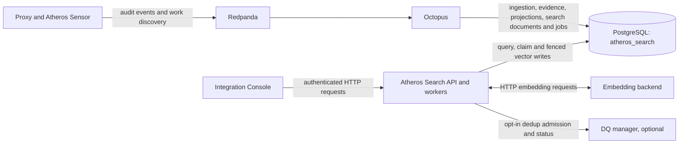

# Atheros Search and Integration Console

This directory is the Atheros Search project: the query and embedding control
plane for wireless audit data, plus its browser UI. It is not an independent
collector, ingestion service, schema migrator, or source of durable wireless
truth. Its boundaries are deliberate:

- producers publish audit events and work-discovery messages;
- Octopus owns durable ingestion, evidence, projections, and alert derivation;
- Atheros Search queries the search-facing PostgreSQL domain and, when enabled,
  executes embedding jobs prepared by Octopus;
- the Integration Console is the authenticated browser client for those APIs.

The repository-level [system architecture](../../docs/architecture.md) is the
canonical whole-stack description. This README is the entry point for the two
deployable Atheros Search applications and their sources of truth.

## Start here

| If you need to... | Read or use... |
|---|---|
| Understand the two applications and their boundaries | This README |
| Change Go APIs, workers, auth, configuration, or operations | [Atheros Search API README](atheros-search/README.md) |
| Change SolidJS screens, browser auth, or UI API consumption | [Integration Console UI README](atheros-search-ui/README.md) |
| Change package dependencies or shared API contracts | [package map](atheros-search/docs/package-map.md) and [contract inventory](atheros-search/docs/contracts.md) |
| Change tables, grants, or schema checksums | [Atheros Search manifest](../../sql/postgres/atheros_search/manifest.yaml) and the schema executor workflow |
| Change deployment, routing, image pins, or rollout order | [Atheros Search Kustomization](../../cyber-stack/base/atheros-search/) and the [GitOps guide](../../cyber-stack/README.md) |
| Investigate reporting meanings or accuracy gaps | [reporting workmap](../../docs/atheros-reporting-workmap.md) and [reporting data contract](../../docs/atheros-reporting-data-contract.md) |
| Respond to an embedding or search alert | [Atheros Search degraded-mode runbook](../../docs/runbooks/atheros-search-degraded.md) |

## System map



The database arrow from Octopus to `atheros_search` represents shared,
table-granted access, not shared ownership. Octopus prepares search documents
and embedding jobs; Atheros Search owns job claiming, embedding execution and
atomic vector completion. Neither the UI nor the producers receive direct
PostgreSQL access.

## The two applications

| Application | Implementation | Runtime responsibility | Does not own |
|---|---|---|---|
| [Atheros Search](atheros-search/) | Go HTTP/gRPC service | Search, graph, inventory, ETL health, saved views, embedding-job leasing and vector writes | Redpanda ingestion, durable projection maintenance, alert derivation, DDL |
| [Integration Console](atheros-search-ui/) | SolidJS/Bun static web application | Authenticated search, explanation, graph and inventory workflows | Database access, API secrets, server-side authorization |

The API exposes HTTP on port 8080, gRPC on port 50051, and Prometheus metrics
on port 9090. The UI container serves static assets and reverse-proxies its
`/v1/` calls to the API inside the cluster. The API remains the authorization
boundary; browser roles do not replace server-side checks.

## Runtime behaviour

### Query path

The browser obtains a Keycloak access token when Keycloak is configured and
sends it to the API. The API validates issuer, audience, signature and client
roles before it executes dense, sparse, hybrid, graph, inventory, evidence or
ETL-health queries. Static-token digest authentication is a mutually exclusive
local-development option. The UI never contains the API token or DQ delegated
identity.

Search reads the `atheros_search` domain through its dedicated runtime account.
At startup it verifies the selected database, TLS settings, schema manifest
checksum and vector readiness. The canonical manifests and grant templates are
the schema source of truth; application code never applies DDL.

### Embedding path

Octopus prepares active `search_documents` and `embedding_jobs`. Atheros Search
does not process work until `ATHSEARCH_WORKER_ENABLED=true`. When enabled, its
workers claim a lease with a token and fence, commit that claim before calling
the embedding backend, and atomically write a vector and complete the matching
fenced job. Lease renewal and bounded recovery make an interrupted worker safe
to retry without giving a stale worker ownership.

The worker and interactive query lanes share the embedding backend but keep
separate capacity and circuit-breaker state. The complete configuration,
response compatibility and repair procedure live in the
[API README](atheros-search/README.md#embedding-workers) and
[repair CLI guide](atheros-search/scripts/README.md).

### Optional DQ path

The additive dedup routes are disabled unless `ATHSEARCH_DQ_ENABLED=true` and
their required service configuration is present. Atheros Search delegates only
admission and status to the [DQ manager](../../services/dq/README.md); it does
not read DQ tables, run processors, or apply a proposal. The UI exposes the
control only behind `VITE_DQ_BETA_ENABLED=true`, while the API independently
enforces the feature and operator/admin authorization.

## Ownership and data semantics

| Concern | Authority | Important constraint |
|---|---|---|
| Event ingestion, dedupe, projection maintenance and alerts | Octopus | Atheros Search must not become a second coordinator |
| Search documents and embedding-job preparation | Octopus through canonical schema contracts | Preparation is separate from vector execution |
| Job claims, leases, vector writes and terminal worker state | Atheros Search | Every worker mutation remains token- and fence-guarded |
| Search-facing tables and grants | `sql/postgres/atheros_search` manifests | Only the provisioning schema executor applies DDL |
| Search, graph, inventory and saved-view APIs | Atheros Search protobuf/HTTP contracts | Producer and UI compatibility checks are required for contract changes |
| Browser presentation and user interactions | Integration Console | It consumes APIs only; it has no database fallback |
| Reporting language and relationship meanings | Reporting data contract | Observed MACs, AP context, pending candidates and confirmed identities are distinct |

The reporting workmap labels proposed changes separately from current behaviour.
An observed AP association is frame evidence, not verified connectivity, and a
similarity candidate is a pending review item, not a confirmed identity.

## Repository map

```text
apps/integration-console/
|- README.md                     # This project map
|- atheros-search/               # Go API, workers, protobuf contract and tests
|  |- cmd/server/                # Service entry point
|  |- cmd/embedding-job-repair/  # Operator repair CLI
|  |- internal/                  # Feature, transport, auth, DB and worker packages
|  |- docs/                      # Package, contract and quality rules
|  |- proto/                     # Versioned public gRPC/protobuf contract
|  |- scripts/                   # Protobuf and repair tooling
|  `- testdata/contracts/        # Shared synthetic UI compatibility fixtures
`- atheros-search-ui/            # SolidJS browser application
   |- src/api/                   # Typed API client and response validation
   |- src/auth/                  # Keycloak session and safe return-path handling
   |- src/pages/                 # Search, Explain, Graph and Inventory views
   `- tests/                     # Unit, accessibility and browser tests
```

## Development and verification

Run focused checks from the repository root:

```bash
make atheros-search-test
make atheros-search-quality
make atheros-search-ui-check
```

The quality command includes Go formatting, vet, race tests, lint, package
boundaries, protobuf comparison and shared-fixture checks. UI checks run the
full UI test suite and production build. The required database and stack
contract checks need an absolute repository path and their documented local
dependencies:

```bash
make atheros-search-stack-contract
make atheros-search-db-contract
```

Use [Atheros Search maintenance rules](atheros-search/docs/quality.md) for
the exact prerequisites and command scope. Run `make docs-check` after README
or other Markdown changes.

## Delivery and operations

The two images and their in-cluster services are declared together in
[`cyber-stack/base/atheros-search`](../../cyber-stack/base/atheros-search/).
Production image digests and environment-specific API settings are reviewed in
[`cyber-stack/matrix/prod/app-stack`](../../cyber-stack/matrix/prod/app-stack/).
Argo CD reconciles that desired state; changes to configuration, routing,
network policy, scaling and image promotion are Git changes, not interactive
cluster edits.

| Endpoint | Meaning |
|---|---|
| `GET /healthz` | API process is alive |
| `GET /readyz` | Database, schema and vector readiness gate has passed |
| `GET /v1/etl/health` | Cached worker/job and semantic embedding health snapshot |

For alert response, check the [degraded-mode runbook](../../docs/runbooks/atheros-search-degraded.md)
before changing a worker, backend or database setting. Operational logs and
metrics must not include raw queries, tokens, full MACs or user identifiers;
the [privacy policy](../../docs/atheros-search-privacy.md) defines the data
handling boundary.
